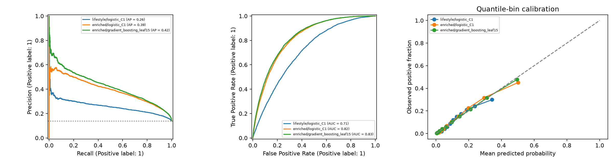
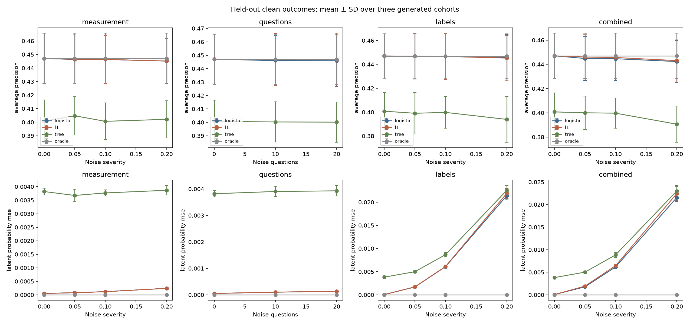
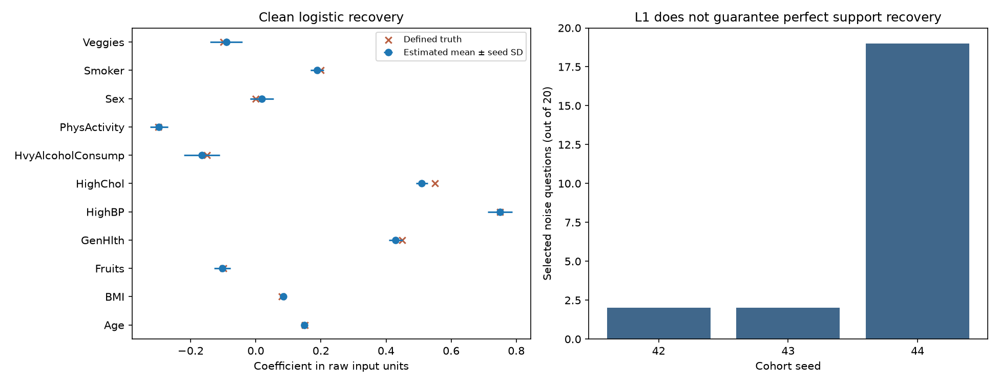

# Diabetes status classification and controlled noise robustness

Machine Learning final project — ESILV A4 DIA3

Louis Le Forestier and Team

Experimental run: 16 November 2026

## Abstract

This project examines the information available for classifying diabetes status
in a self-reported survey, then studies parameter recovery under controlled noise.
The real-data phase uses the full UCI CDC Diabetes Health Indicators binary export
of 253,680 respondents. A stratified 20% test set is reserved before exploratory
analysis. Twenty-eight configurations are compared using identical five-fold
cross-validation splits on development data, with average precision (AP) as the
selection metric. The selected enriched gradient-boosting model achieves test AP
0.4247 and ROC-AUC 0.8274, compared with AP 0.2763 for the corresponding lifestyle
and demographic model. A 10-variable RFE logistic model retains most of the full
logistic model's AP (0.3928 versus 0.3942).

The synthetic phase preserves the supplied logistic generator and evaluates
12 noise scenarios on three cohorts of 50,000 observations. Clean logistic
regression recovers the assumed signal coefficients with mean RMSE 0.0297.
Symmetric label noise substantially worsens probability accuracy while changing
AP comparatively little. L1 regularization selected for predictive AP does not
reliably eliminate every irrelevant question. These results distinguish
classification, probability accuracy and variable recovery; they do not establish
causal relationships or clinical usefulness.

## 1. Problem and data

The real-data question is: how well can lifestyle and demographic information
identify respondents reporting diabetes or prediabetes, and how much do additional
health indicators improve classification? The outcome describes status at survey
time. It does not measure future disease onset.

The selected source is UCI dataset 891, with 21 predictors and an `ID` column.
The exact binary export contains 218,334 negatives and 35,346 positives (13.93%).
The selected dictionary codes `Diabetes_binary=1` as prediabetes or diabetes. The
UCI landing page also discusses a three-class variant, so the pinned file is
essential to interpreting the target. The SHA-256 checksum is
`9f71fda9d4ae5f4878c99b9233b6a16accfa9a17c194116a6b78100540934964`.

The lifestyle/demographic model uses physical activity, fruits, vegetables,
smoking, heavy alcohol consumption, recorded sex, age band, education and income.
The enriched model adds BMI, blood pressure, cholesterol, cholesterol checks,
stroke, heart disease, general/mental/physical health, walking difficulty and two
healthcare-access indicators. ID and the target are excluded from all inputs.
Age is an ordinal band, not a precise age.

Acquisition verifies the checksum, schema, row count, target counts, missingness,
integer category values and ranges. No values are missing. Raw downloads remain
outside Git. Repeated predictor profiles are retained because identical responses
do not identify duplicate participants. There are 18,580 repeated profiles within
development and 6,836 test rows with a predictor hash also seen in development.
This does not prove participant leakage; a profile-grouped sensitivity analysis
would investigate generalization to unseen response combinations.

## 2. Real-data experimental method

A deterministic stratified split (seed 42) gives 202,944 development and 50,736
test observations. Exploratory analysis uses development data. Acquisition checks
known global counts only to verify the source export. Scaling and feature
selection are fitted inside each training fold. Ordinal variables remain numeric,
which imposes equal log-odds increments in logistic regression. Trees can learn
nonlinear splits without that linear assumption.

For each of the two feature sets, the study compares a majority baseline,
logistic regression with C in {0.1, 1, 10}, balanced logistic regression,
depth-3/5 trees, Gaussian naive Bayes, a random forest and histogram gradient
boosting with 15/31 leaves. The forest has 100 trees, maximum depth 12 and minimum
leaf size 10. Boosting uses 150 iterations, learning rate 0.08, L2 regularization
1 and no early stopping. This is a modest, explicit search budget.

Six additional enriched logistic pipelines evaluate mutual-information filtering
and RFE with 5/10 variables, and L1 selection with C in {0.001, 0.01}. The final
classifier in these pipelines is logistic regression with C=1. Mutual information
treats the integer-coded survey responses as discrete; RFE removes up to four
features per step. All 28 configurations share five shuffled stratified folds.

Mean fold AP selects the primary model. AP is the weighted precision summary
implemented by `average_precision_score`, not trapezoidal PR-AUC. Fold SD is
reported as descriptive variation. Because CV also selects configurations, those
scores are optimistic selection estimates, not nested-CV performance estimates.

The best model from each feature set, fixed logistic baselines, majority baseline
and best candidate from each selection method are retained for final comparison.
Each nontrivial finalist receives a threshold maximizing F1 on its out-of-fold
development predictions. The primary model and all thresholds are written to a
freeze file before test evaluation. Test labels do not determine models, feature
sets, thresholds or calibration. All finalists are then refitted on development.

## 3. Real-data results

| Model | Final inputs | Development AP, mean ± fold SD | Test AP | Test ROC-AUC | Test Brier |
| --- | ---: | ---: | ---: | ---: | ---: |
| Majority | 21 supplied | 0.1393 ± 0.0000 | 0.1393 | 0.5000 | 0.1393 |
| Lifestyle logistic, C=1 | 9 | 0.2542 ± 0.0029 | 0.2571 | 0.7113 | 0.1126 |
| Enriched logistic, C=1 | 21 | 0.4076 ± 0.0049 | 0.3942 | 0.8192 | 0.1000 |
| Lifestyle gradient boosting | 9 | 0.2747 ± 0.0032 | 0.2763 | 0.7244 | 0.1108 |
| Enriched gradient boosting | 21 | **0.4359 ± 0.0084** | **0.4247** | **0.8274** | **0.0973** |
| MI logistic | 10 | 0.4012 ± 0.0047 | 0.3886 | 0.8149 | 0.1006 |
| RFE logistic | 10 | 0.4048 ± 0.0055 | 0.3928 | 0.8186 | 0.1000 |
| L1-selected logistic | 20 | 0.4076 ± 0.0049 | 0.3942 | 0.8192 | 0.1000 |

The enriched gradient-boosting model is selected by development AP. Its held-out
AP exceeds the corresponding lifestyle model by 0.1484. For fixed logistic
regression, the enriched improvement is 0.1372. These are descriptive differences;
no paired significance or equivalence test is claimed. Feature-selection
comparisons are made against full logistic regression, keeping the classifier
family constant. RFE reduces 21 variables to 10 with a test AP difference of
−0.0014. L1 preserves performance here but provides little reduction at the
selected strength. Its final subset can differ from individual CV subsets.



For the primary model, 200 stratified test bootstraps give a 95% percentile AP
interval [0.4141, 0.4350] and ROC-AUC interval [0.8223, 0.8317]. These condition on
the fixed model, threshold and observed prevalence; they do not incorporate
training, selection, survey-design or external-population uncertainty.

### Threshold trade-off and errors

| Operating point | Accuracy | Recall | Precision | F1 | False-positive rate |
| --- | ---: | ---: | ---: | ---: | ---: |
| Default threshold 0.5 | 0.8653 | 0.1616 | 0.5573 | 0.2505 | 0.0208 |
| Development F1 threshold 0.2316 | 0.8069 | 0.6111 | 0.3801 | 0.4687 | 0.1614 |

At the selected threshold, the confusion matrix contains 36,621 true negatives,
7,046 false positives, 2,749 false negatives and 4,320 true positives. Lowering the
threshold improves recall but increases false positives and lowers precision.
F1 is a reproducible experimental criterion, not a clinical utility function.
The majority classifier reaches 86.07% accuracy while missing every positive.

Brier loss measures overall probability error, not calibration alone. Quantile-bin
reliability curves provide a complementary descriptive check. No test-fitted
calibrator is used. Logistic coefficients are conditional associations; neither
positive nor negative weights establish harmful or protective causal effects.

### Subgroup analysis

The same threshold applies to every subgroup. Male/female recall is 61.41%/60.84%,
while false-positive rates are 18.10%/14.65%. Age-group recall is 28.98% for 18–44,
60.58% for 45–64 and 65.56% for 65+. Corresponding false-positive rates are 2.02%,
14.89% and 28.19%. Group sizes are 10,962, 21,855 and 17,919 respectively.

These differences reflect different prevalence, feature distributions and model
behavior. They do not isolate a causal explanation or constitute a formal fairness
audit. No subgroup-specific threshold was tuned on these test outcomes.

## 4. Synthetic method

The second phase studies a known logistic equation:

```text
logit(p) = -4.80 + .08(BMI - 25) + .75 HighBP + .55 HighChol
           + .45(GenHlth - 1) + .15(Age - 1) - .30 PhysActivity
           + .20 Smoker - .15 HvyAlcoholConsump - .10 Fruits - .10 Veggies
```

Sex has true weight zero. An independent Bernoulli draw with probability p
generates the outcome. The assumed coefficients are not epidemiological estimates.
The original age, BMI, lifestyle and correlated health-variable distributions
are preserved. They produce 18.89–19.17% positive outcomes across three cohorts,
not the approximately 14% originally described in the starter prose.

Each cohort has 50,000 observations (seeds 42, 43, 44), with 40,000 development and
10,000 test rows. Within a cohort, all scenarios share the same split and folds.
The twelve scenarios comprise a clean baseline, three measurement severities,
two question-noise counts, three label-flip rates and three combined conditions.

At measurement severity r in {0.05, 0.10, 0.20}, respondents with BMI above 27
under-report by Uniform(0.5, 3) × r/0.2 and round to one decimal. A fraction r of
smokers conceal smoking. Extra questions are 10 or 20 independent alternating
Bernoulli/Gaussian variables. Label noise flips development labels symmetrically
at rates 5%, 10% or 20%. Combined scenarios use matching measurement/label severity
plus 10 questions. Error draws are paired across severity levels.

Both development and test inputs receive measurement errors, but test outcomes
remain clean. Clean BMI/smoking backups, true probabilities and outcomes are
excluded from inputs. Validation sees the available, potentially corrupted labels.
An oracle uses known latent probabilities only for evaluation. A separate clean
logistic model is frozen and transferred to each observed-feature scenario.

The candidates are unpenalized logistic regression, L1 logistic regression with
C in {0.01, 0.1, 1}, and decision trees of depth 3/5 with minimum leaf size 50.
Five-fold AP selects within each family and scenario. Scalers remain inside the
folds. All scenario configurations are frozen before evaluating a cohort's test
set. The budget is 1,080 development fits plus final refits.

## 5. Synthetic results

| Condition | Logistic test AP, mean ± seed SD | Mean Brier | Mean latent-probability MSE |
| --- | ---: | ---: | ---: |
| Clean | 0.4470 ± 0.0187 | 0.1281 | 0.000052 |
| 20 irrelevant questions | 0.4459 ± 0.0192 | 0.1282 | 0.000135 |
| Label flips, 20% | 0.4456 ± 0.0193 | 0.1494 | 0.021386 |
| Combined severity 0.20 | 0.4423 ± 0.0172 | 0.1495 | 0.021558 |



Symmetric label noise changes the observed conditional probability to
r + (1 − 2r)p. For r < 0.5, this preserves its population ordering while moving
probabilities toward 0.5. This explains why probability error increases much more
than AP in the experiment. Brier includes irreducible Bernoulli outcome noise;
latent-probability MSE compares predictions directly with the known probability.

The clean decision tree has mean AP 0.4008 and Brier 0.1321, below the clean
logistic model's ranking performance. The generator favors logistic regression
by construction, so this does not establish a universal model preference.
A fitted model may slightly exceed the oracle's realized test AP because the
finite sample contains random outcomes. The oracle remains the correct latent
probability reference, not a guaranteed ceiling on every realized sample metric.

### Parameter and support recovery

The logistic coefficients are divided by training standard deviations before
comparison. The raw intercept also subtracts the fitted mean shift. The true
raw-coordinate intercept is −7.40, rather than the centered −4.80.

The mean clean signal-coefficient RMSE is 0.0297. Under combined severity 0.20 it
is 0.2422. With noisy measurements or labels, the conditional model differs from
the clean equation; this measures departure from the clean reference.



For twenty irrelevant questions, the AP-selected L1 model retains 2, 2 and 19
questions across seeds 42, 43 and 44. Sex is also counted separately as a known
null predictor. L1 sparsity is sensitive to the selected regularization strength;
optimizing predictive AP does not guarantee exact support recovery. Trees report
impurity importance rather than signed coefficients, with the usual limitations
under correlated inputs.

All synthetic SDs describe variability across three cohorts. They are not 95%
confidence intervals, and three replications are insufficient for precise
significance conclusions.

## 6. Synthesis and limitations

The CDC results show that reported health indicators add predictive information
beyond lifestyle and demographics for current survey status. The controlled
experiment explains why good ranking, accurate probabilities and identification
of true variables are separate objectives. It does not validate the CDC weights
as causal mechanisms.

The survey is observational, self-reported and not accompanied by the weights
needed for population prevalence analysis. Some indicators may follow an existing
diagnosis. The single row split, limited tuning budget, numeric ordinal encoding
and descriptive subgroup analysis restrict the conclusions. The selected threshold
has not been assessed under a clinical cost model or external validation.

The simulator has a logistic truth, partly independent lifestyle variables,
stylized reporting errors and a large sample relative to dimensionality. Its
prevalence and target construction differ from CDC, so AP cannot be compared
across phases as though the populations matched. Future experiments could test
nonlinear truth, smaller samples, asymmetric label noise, ordinal encodings and
profile-grouped validation. These are future extensions, not completed evidence.

## 7. Reproducibility and deliverables

The companion repositories are `groupe-dia3-ml/cdc-benchmark` and
`groupe-dia3-ml/synthetic-data`. Each contains executable source, pinned direct
dependencies, tests, an executed notebook and saved machine-readable results.
Both use `python -m src.experiment`; `python scripts/execute_notebook.py` renders
verified saved results, and `RERUN_EXPERIMENTS=1` forces recomputation.

The recorded environment is Python 3.14.10, NumPy 2.5.3, pandas 3.0.5,
scikit-learn 1.9.1 and Matplotlib 3.11.1. Complete package inventories, source
fingerprints, dataset checksum, seeds, fold scores, selection freezes, runtime
and final metrics are retained. CDC uses 200 conditional test bootstraps.

The reports in this repository include an evidence snapshot with SHA-256 hashes
and figures, so the narrative can be checked without downloading the raw survey.
The [oral defense notes](ORAL_DEFENSE.md) provide a presentation sequence and
answers to likely methodological questions. Team-member responsibilities should
be recorded by the group; no unverified individual contribution is claimed.

## References

1. CDC Diabetes Health Indicators [Dataset]. (2017). UCI Machine Learning Repository.
   [DOI: 10.24432/C53919](https://doi.org/10.24432/C53919).
   [Dataset and dictionary](https://archive.ics.uci.edu/dataset/891/cdc+diabetes+health+indicators).
   The citation year is not asserted to be the survey year.
2. [Selected CSV](https://archive.ics.uci.edu/static/public/891/data.csv).
   [Original collection and source terms](https://www.kaggle.com/datasets/alexteboul/diabetes-health-indicators-dataset).
   Preserve the dataset acknowledgements; raw data are not redistributed here.
3. scikit-learn: [common pitfalls and pipelines](https://scikit-learn.org/stable/common_pitfalls.html),
   [average precision](https://scikit-learn.org/stable/modules/generated/sklearn.metrics.average_precision_score.html),
   [feature selection](https://scikit-learn.org/stable/modules/feature_selection.html).
4. Synthetic population and coefficient assumptions: the supplied starter notebook
   in the project's `synthetic-data` repository. Original distributions and outcome
   equation are preserved, with their realism limits explicitly stated above.
